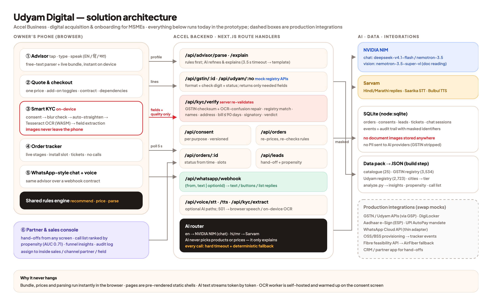

# Udyam Digital — Accel Business

**YTL Hackathon 2026 · Track A.** A small-business owner discovers the right bundle, buys it, verifies their business and tracks activation — on a phone, in English, हिंदी or मराठी, with no sales visit.

| | |
|---|---|
| **Advisor** `/advisor` | Tap chips, type or speak. A free-text parser (works offline in all three languages) and a deterministic rules engine build the bundle live; AI only explains it. |
| **Quote** `/quote` | One monthly price (+GST, setup) · contract 12/24/36 · add-on toggles with dependency locks · speed switcher · share on WhatsApp. |
| **Smart KYC** `/kyc` | Per-purpose consent → on-device blur check, auto-straighten, OCR → server checks GSTIN checksum, registry status, names, address, 90-day bill, signatory → one-tap fixes → Aadhaar e-sign (mock). |
| **Tracker** `/track/:id` | Live stages, install slot, per-service status, tickets, "your data" (download / withdraw consent). |
| **Chat** `/chat` | WhatsApp-style front end over `POST /api/whatsapp/webhook` (same contract a WhatsApp Cloud API adapter would use) with voice. |
| **Partner console** `/partner` | Hand-offs from every screen · dropped leads ranked by a propensity model (AUC 0.71) with next best action · funnel insights · audit log. |

## Run it

```bash
npm install
npm run dev          # http://localhost:3000
npm test             # 40 tests: 12 KYC applicants, 15 advisor scenarios, 400-profile safety sweep, personas in 3 languages
npm run build && npm start
```

No API keys needed: every AI path has a deterministic fallback. To turn AI on, copy `.env.example` to `.env.local` and add `NVIDIA_API_KEY` / `SARVAM_API_KEY`. Then run `npx tsx --env-file=.env.local scripts/bakeoff.ts` to pick the fastest accurate models.

Regenerate data and the model from the CSVs: `npm run data` (Node + Python with pandas/scikit-learn).

## Smart KYC on the 12 specimen applicants

| | Planted problem | Result |
|---|---|---|
| K01 | GSTIN cancelled; Udyam number missing | Blocked for GST products; non-GST bundle offered |
| K02 | Tilted scan | Auto-straightened 7°, matched by name → verified |
| K04 | Blurry GST certificate | "Retake in good light" |
| K05 | No Udyam certificate | Found in Udyam records, no upload needed |
| K06 | GSTIN fails its check digit | Flagged; suggests the registered GSTIN |
| K07 | Legal name differs from GST records | Flagged as a possibly edited certificate |
| K10 | (OCR misreads I as J) | Auto-corrected via registry → verified |
| K11 | Bill older than 90 days | "Upload a recent bill" |
| K03, K08, K09, K12 | — | Verified |

## Architecture



- **Never hangs:** bundle, prices and parsing run in the browser; pages are pre-rendered; AI streams with a 3.5 s timeout and falls back to templates; the OCR worker is self-hosted and warmed up on the consent screen.
- **Never wrong on rules:** `lib/engine/recommend.ts` is the only thing that picks products, and `/api/orders` re-checks eligibility and re-prices every order on the server.
- **Privacy:** images stay on the phone; the server gets extracted fields only; identifiers are masked in the UI and logs; retention is enforced on start. See `docs/privacy-note.pdf`.

## Repo map

```
app/                 pages + API route handlers (Next.js 16, App Router)
components/          advisor, quote, kyc, tracker, chat, partner, landing, ui kit
lib/engine/          recommend · pricing · parse (EN/HI/MR) · explain
lib/kyc/             gstin (checksum, OCR repair) · extract · validate · registry · image (on-device)
lib/ai/router.ts     NVIDIA NIM + Sarvam with timeouts and fallbacks
lib/i18n/            English, Hindi, Marathi
analysis/analyze.py  funnel insights + propensity model → lib/generated/
docs/                business case (.pptx/.pdf), architecture, privacy note, demo script
```

All data is synthetic, from the hackathon pack. "Today" for KYC date checks is 15 Jul 2026, as the data README specifies.
